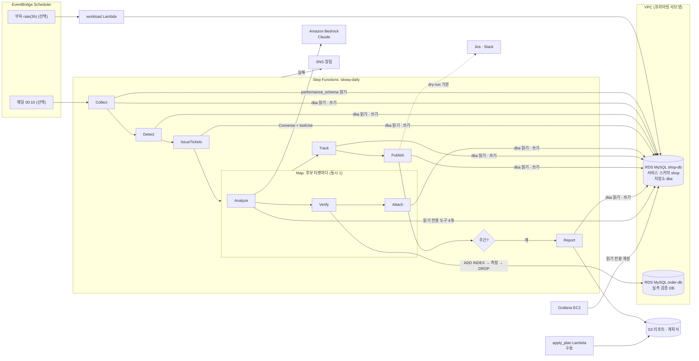

# slowq on AWS — 슬로우 쿼리 자동화를 AWS 에 올리기

`lab/`(실습) · `skeleton/`(워킹 스켈레톤)과 같은 흐름 — **수집 → 검출 → 티켓 → AI 분석 → 실측 검증 → 결과 첨부 → 해결 · 재발 추적 → 발행 → 주간 리포트** — 을
AWS 관리형 서비스로 옮긴 버전입니다. Terraform 한 번으로 VPC · RDS MySQL 두 대 · Lambda · Step Functions · Grafana(EC2)가 만들어집니다.

- 순수 로직(수집 차이 계산 · 검출 규칙 · 마스킹 · 티켓 상태 · 검증 판정 · AI 출력 파싱)은 `skeleton/slowq` 를 **그대로** Lambda 패키지에 싣습니다.
- AI 진단은 Claude Code + MCP 대신 **Amazon Bedrock Converse API** 를 Lambda 안에서 부르고, 근거 도구 4가지를 Lambda 함수로 구현했습니다.
- **운영 DDL 은 자동으로 실행하지 않습니다.** 검증 DB 에서만 인덱스를 만들었다가 되돌리고, 운영 반영은 계획서를 만든 뒤 사람이 승인해 실행합니다.

> 처음 설치하거나 문제를 진단한다면 [운영 안내](OPERATIONS.md)를 순서대로 따르세요. 전체 소스 검사 범위는 [SOURCE_REVIEW.md](SOURCE_REVIEW.md)에 있습니다.

> 독립 검증 스택에서 MySQL 8.4·Lambda·Step Functions·Bedrock·Grafana의 실제 실행을 확인했습니다. 검증 범위와 재현 조건은 `LIVE_VALIDATION.md`에 기록합니다. Jira·Slack은 dry-run이며 범용 운영 배포 보증은 아닙니다.

## 처음이라면 — 이 폴더 사용법

- **비용이 듭니다.** `terraform apply` 순간부터 지속적으로 요금이 발생합니다(2장). 실습이 끝나면 반드시 `terraform destroy` 합니다. 로컬 `lab/` 실습을 먼저 끝까지 해 보고 오는 것을 권합니다.
- **돈이 들지 않는 단계부터**: 아래 순서 중 빌드·정적 검증은 AWS 계정 없이도 됩니다. 삭제 권한 점검은 계정이 필요합니다.
  1. `aws` 폴더에서 `scripts/build.sh` → 마지막에 `function.zip` · `layer.zip` 해시 두 줄이 나오면 성공
  2. `aws` 폴더에서 `scripts/validate.sh` → 끝에 `PASS  …` 목록이 나오고 `FAIL` 이 없으면 성공
  3. [OPERATIONS.md](OPERATIONS.md)의 계정·삭제 권한 점검 후 `aws/terraform`에서 `init` → `plan` → `apply` (여기부터 과금)
  4. `terraform output -raw next_steps` 가 알려 주는 명령으로 `init-db` → 상태 머신 실행 → Grafana 확인
  5. 다 봤으면 `terraform destroy`
- **하위 폴더 안내**

  | 폴더 | 무엇 | 안내 |
  |---|---|---|
  | `terraform/` | VPC · RDS · Lambda · Step Functions · Grafana EC2 를 만드는 IaC | [terraform/README.md](terraform/README.md) |
  | `lambda/` | Lambda 핸들러 코드(`slowq_aws`) · 레이어 의존성 | [lambda/README.md](lambda/README.md) |
  | `statemachine/` | 하루 배치 상태 머신 정의(ASL) | [statemachine/README.md](statemachine/README.md) |
  | `scripts/` | 패키지 빌드 · 정적 검증 스크립트 | [scripts/README.md](scripts/README.md) |
  | `sql/` | AWS 용 저장소 스키마 | [sql/README.md](sql/README.md) |
  | `grafana/` | Grafana EC2 설치 스크립트 템플릿 | [grafana/README.md](grafana/README.md) |
  | `tests/` | 핸들러 단위 테스트 (AWS 없이 실행) | [tests/README.md](tests/README.md) |

- 전체 여정 그림은 [docs/GETTING_STARTED.md](../docs/GETTING_STARTED.md) 의 AWS 경로를 보세요.

## 1. 구조



### 리소스

| 파일 | 리소스 | 하는 일 |
|---|---|---|
| `terraform/network.tf` | VPC · 퍼블릭 2 · 프라이빗 2 서브넷 · 보안 그룹 · S3 게이트웨이 엔드포인트 · (NAT 끔) 인터페이스 엔드포인트 · (선택) NAT | RDS 와 Lambda 는 프라이빗. NAT 를 끄면(기본) Secrets Manager · Bedrock 런타임은 VPC 엔드포인트로 나갑니다 |
| `terraform/rds.tf` | RDS MySQL 8.4 × 2 (`db.t4g.micro`) · 파라미터 그룹 | `performance_schema=1`, digest 크기 · 길이, `slow_query_log=1`, `long_query_time=0.5`, TLS 강제. 마스터 비밀번호는 RDS 가 Secrets Manager 에서 관리 |
| `terraform/secrets.tf` | Secrets Manager × 8 (+ RDS 관리 2) · `random_password` | 최소 권한 DB 계정 6개 · Grafana 관리자 · 발행 자격 증명(선택) |
| `terraform/iam.tf` | Lambda 함수별 역할 · Step Functions · Scheduler 역할 | 함수마다 자기 비밀 · 자기 로그 그룹 · 자기 S3 경로만. Bedrock 은 설정한 모델(추론 프로필)만 |
| `terraform/lambda.tf` | Lambda 12개 + 레이어(pymysql · cryptography) | 패키지 하나를 공유하고 핸들러만 다름 (arm64 · python3.12) |
| `terraform/stepfunctions.tf` | 상태 머신 `slowq-daily` | `statemachine/daily.asl.json` 을 `templatefile` 로 채움. 실행 데이터는 로그에 남기지 않음 |
| `terraform/schedule.tf` | EventBridge Scheduler × 2 | 일일 실행(기본 꺼짐) · 부하 발생(선택) |
| `terraform/grafana.tf` | EC2 `t4g.small` (AL2023 arm64) · 보안 그룹 · 인스턴스 역할 | Grafana OSS 설치, MySQL 데이터 소스(TLS · 읽기 전용 계정), `lab/grafana` 대시보드 그대로 |
| `terraform/monitoring.tf` | SNS 토픽 · CloudWatch 경보 | 상태 머신 실패 · 시간 초과 · 중단, 검증 Lambda 오류 → SNS(이메일 선택) |
| `terraform/main.tf` | S3 버킷 | 리포트 · 변경 계획서 · 대시보드 JSON (비공개 · 암호화 · TLS 강제) |

### Lambda

| 함수 | 단계 | 쓰는 DB 계정 | 비고 |
|---|---|---|---|
| `init-db` | 한 번 | 마스터(RDS 관리 비밀) | `lab/mysql/init/01_shop.sql`(샘플 200만 행) · `sql/02_store.sql` · 계정 6개 · CMDB 2행. 다시 실행해도 안전 |
| `workload` | 선택 스케줄 | `slowq_workload` (shop SELECT) | `lab/scripts/workload.py` 와 같은 쿼리 |
| `collect` | Collect | `slowq_collector` · `slowq_store` | CMDB 의 `collect=1` 클러스터만. 첫 실행은 기준 스냅숏만 |
| `detect` | Detect | `slowq_store` | `slowq.detect` 그대로 |
| `issue-tickets` | IssueTickets | `slowq_store` | `slowq.tickets.issue` + 분석 후보 상위 `analyze_max` 개 |
| `analyze` | Map/Analyze | `slowq_ai` (읽기 전용) | Bedrock Converse + 도구 4개, 엄격한 JSON |
| `verify` | Map/Verify | `slowq_verify` (검증 DB shop 만) | ADD INDEX 한 절만, 항상 되돌림 |
| `attach` | Map/Attach | `slowq_store` | `tuning_ticket.recommendation` · `AI_ANALYZED` 이벤트 |
| `track` | Track | `slowq_store` | `slowq.tickets.track` 그대로 |
| `publish` | Publish | `slowq_store` | 기본 dry-run, Jira REST v2/v3 · Slack `chat.postMessage` |
| `report` | Report (주 1회) | `slowq_store` | S3 `reports/<날짜>/weekly.md · .html` |
| `apply-plan` | 수동 | `slowq_ai` · `slowq_store` | 계획서만 S3 `plans/` 에. **DDL 실행 없음** |

## 2. 하루 비용 (대략)

배포 전 [AWS 요금 계산기](https://calculator.aws/)에 실제 리전·가동 시간·인스턴스·스토리지·추론 모델을 입력하세요. 확정 청구 금액을 검증한 기록은 없습니다.

- RDS 2대와 스토리지, Grafana EC2/EBS·퍼블릭 IPv4, 인터페이스 엔드포인트, Secrets Manager는 실행하지 않는 동안에도 비용이 발생할 수 있습니다.
- Bedrock 비용은 입력·출력 토큰 및 실행 횟수에 따라 달라집니다. `analyze_max`는 **실행 한 번**의 후보 상한이며 일일 예산 제한이 아닙니다.
- NAT를 켜면 게이트웨이 시간·처리 비용이 추가됩니다. 실습 종료 후 삭제 완료와 잔존 자원을 모두 확인하세요.

## 3. 준비

- Terraform ≥ 1.5, AWS CLI v2, Python 3.12+ (`pip`), `curl`. 로컬 검증 의존성은 `python3 -m pip install -r requirements-dev.txt`
- 배포할 AWS 계정의 자격 증명 (관리자 또는 VPC · RDS · Lambda · IAM · Step Functions · EC2 · S3 · Secrets Manager · SNS · Scheduler 생성 권한)
- Bedrock 모델 사용 권한: Anthropic 모델은 처음 쓸 때 콘솔에서 사용 사례 제출이 필요할 수 있습니다
- (선택) Session Manager 플러그인 — Grafana 를 인터넷에 열지 않고 포트 포워딩으로 볼 때

### 삭제 권한을 배포 전에 확인

생성 권한이 있어도 삭제가 명시적으로 거부될 수 있습니다. `scripts/preflight.py --profile <승인된 프로필> --expected-account <12자리 계정> --prefix <검증 접두어>`로 계정과 두 RDS의 삭제 권한 시뮬레이션을 먼저 확인하세요(로컬 boto3 필요). `explicitDeny`, 누락 컨텍스트, 시뮬레이션 권한 오류가 있으면 생성하지 말고 승인된 삭제 경로를 먼저 마련합니다. 시뮬레이션은 SCP·리소스 정책·태그 조건과 실제 서비스 삭제를 보장하지 않습니다.

### 배포 계정과 MySQL 버전

`expected_account_id`를 실제 배포 계정 ID로 지정하면 다른 계정의 인증으로 배포·삭제하는 것을 차단합니다. 기본 MySQL은 8.4이며 파라미터 그룹도 mysql8.4로 선택합니다. MySQL 8.0을 선택하면 표준 지원 종료와 Extended Support 비용을 먼저 확인하세요. 지원 마이너 버전은 배포 리전의 `describe-db-engine-versions` 결과를 확인합니다.

### Bedrock 모델 ID

기본값은 `global.anthropic.claude-sonnet-4-6` 입니다 (AWS Bedrock 문서의 Claude Sonnet 4.6 모델 카드 기준, 2026-10 확인).

- 서울(`ap-northeast-2`)에서 Claude Sonnet 4.6 · 4.5 는 **in-region 호출과 지역(geo) 프로필이 없고 global 교차 리전 추론 프로필만** 지원합니다. 그래서 `global.` 접두어를 씁니다. global 프로필은 요청을 다른 상용 리전에서 처리할 수 있으므로, 데이터 거주 요건이 있으면 지역 프로필이 있는 리전(예: `us-east-1` + `us.anthropic.claude-sonnet-4-6`, `ap-northeast-1` + `jp.anthropic.claude-sonnet-4-6`)을 쓰세요.
- 형식: `<global|us|eu|jp|au|apac>.anthropic.<모델>` (추론 프로필) 또는 `anthropic.<모델>` (in-region 이 지원되는 리전만). 버전이 붙은 예: `global.anthropic.claude-sonnet-4-5-20250929-v1:0`.
- IAM 은 이 값을 해석해 **추론 프로필 ARN** + 그 프로필을 거칠 때만 허용되는 **기반 모델 ARN**(global 이면 리전 없는 ARN 포함, `bedrock:InferenceProfileArn` 조건)만 허용합니다 (`terraform/iam.tf`).
- 모델이 바뀌면 변수만 바꿉니다: `terraform apply -var bedrock_model_id=...`

## 4. 배포

```bash
cd aws
scripts/build.sh                                   # build/function.zip · build/layer.zip (결정적)
scripts/validate.sh                                # 정적 검증 (선택이지만 권장)

cd terraform
cp example.tfvars terraform.tfvars                 # 값 수정 (토큰은 이 파일에만, 커밋 금지)
terraform init
terraform plan -out tfplan
terraform apply tfplan                             # 15~20분 (RDS 생성이 대부분)
terraform output -raw next_steps                   # 아래 명령이 내 환경 값으로 채워져 나온다
```

apply 다음 순서 (`next_steps` 출력과 같음):

```bash
# 1) 샘플 데이터 · 저장소 스키마 · 계정 · CMDB (수 분, 한 번)
aws lambda invoke --function-name slowq-init-db --cli-read-timeout 910 \
  --payload '{}' --cli-binary-format raw-in-base64-out /dev/stdout
#    - 시간이 모자라다는 응답이면 {"only": "verify"} 로 한 번 더
#    - "덜 만들어져 있습니다" 오류면 {"reset_shop": true} 로 다시 (샘플 스키마만 지우고 새로 만듦)

# 2) 기준 스냅숏 (첫 수집은 기준만 남김)
aws stepfunctions start-execution --state-machine-arn <state_machine_arn> --input '{}'

# 3) 부하 (enable_workload=true 면 3시간마다 자동)
aws lambda invoke --function-name slowq-workload --cli-read-timeout 910 \
  --payload '{"scale": 1.0}' --cli-binary-format raw-in-base64-out /dev/stdout

# 4) 다음 날(또는 날짜를 지정해) 다시 실행하면 하루치 차이 → 검출 → 티켓 → 분석이 돈다
aws stepfunctions start-execution --state-machine-arn <state_machine_arn> --input '{"log_date": "2026-10-14"}'
```

### Grafana 열기

```bash
# grafana_allowed_cidrs 를 비웠다면 (기본) — SSM 포트 포워딩 후 http://localhost:3000
aws ssm start-session --target <grafana_instance_id> \
  --document-name AWS-StartPortForwardingSession --parameters '{"portNumber":["3000"],"localPortNumber":["3000"]}'

# 관리자 비밀번호 (화면에 직접 띄울 때만)
aws secretsmanager get-secret-value --secret-id <grafana_admin_secret_arn> --query SecretString --output text
```

대시보드는 `lab/grafana/dashboards/slowquery.json`(=`lab/grafana/make_dashboard.py` 의 출력)을 그대로 쓰고, 데이터 소스 uid 만 `slowq-store` 로 바꿉니다. 데이터 소스 주소는 Terraform 이 대상 RDS 주소로 채웁니다. 설치가 끝나기까지 apply 후 3~5분 걸리고, `init-db` 를 실행하기 전에는 데이터 소스 접속이 실패합니다.

## 5. 운영

### 상태 머신 수동 실행

```bash
aws stepfunctions start-execution --state-machine-arn <arn> --input '{}'                          # 어제
aws stepfunctions start-execution --state-machine-arn <arn> --input '{"log_date": "2026-10-12"}'  # 지정한 날
```

- 입력이 `{}` 이면 `log_date` = `schedule_timezone` 기준 어제입니다. `log_date` 의 요일이 `report_weekday`(기본 6=일)이면 Report 까지 돕니다.
- 매일 자동 실행은 확인이 끝난 뒤 `schedule_enabled = true` 로 켭니다.
- 실패하면 `NotifyFailure` 가 SNS 로 알리고 실행은 `Failed` 로 끝납니다. 발행 실패는 알리기만 하고 리포트 단계는 계속합니다. 티켓별 분석 · 검증 · 첨부 실패는 그 티켓만 「사람 검토」로 기록하고 다음 티켓으로 넘어갑니다.

### 실제 Jira · Slack 전송 켜기

세 가지가 모두 필요합니다: `publish_dry_run = false`, 자격 증명(`jira` · `slack_bot_token` 또는 `slack_webhook_url`), `enable_nat = true`(Lambda 가 VPC 안에 있어 인터넷으로 나갈 길이 필요). 하나라도 없으면 본문을 로그에만 남기는 dry-run 입니다.
Jira 는 `api_version = "3"`(기본, 설명을 ADF 로 보냄) 또는 `"2"`(일반 문자열)를 고릅니다. 같은 티켓은 `ticket_event` 의 `PUBLISHED` 로 한 번만 만듭니다.

### 운영 반영 (사람 승인)

```bash
aws lambda invoke --function-name slowq-apply-plan --payload '{"ticket_id": 1}' \
  --cli-binary-format raw-in-base64-out /dev/stdout
aws s3 cp s3://<artifacts_bucket>/plans/ticket-1.md -
```

실측 검증을 통과한(`verify.pass`) ADD INDEX 제안만 계획서가 만들어집니다. 계획서에는 사전 점검(긴 트랜잭션 · 스토리지) · 온라인 DDL(`ALGORITHM=INPLACE, LOCK=NONE`, `lock_wait_timeout`) · 되돌리기 · 사후 확인 · 승인 체크박스가 들어 있고, **실행은 담당자가 직접** 합니다. 다음 날 Track 단계가 해결 여부를 판정합니다.

### 삭제

```bash
cd aws/terraform
terraform destroy
```

RDS 는 최종 스냅숏 없이 지워지고(`skip_final_snapshot = true`), S3 버킷은 리포트까지 함께 지워집니다(`force_destroy = true`). 비밀은 복구 대기 없이 즉시 지워집니다. 운영에서 쓸 때는 세 값을 모두 바꾸세요.

## 6. 보안

- **최소 권한 DB 계정** — 수집(`performance_schema` SELECT) · 저장소(`dba` DML) · AI(`shop` SELECT + `dba.slow_digest_daily` SELECT) · 검증(검증 DB 의 `shop` 에서만 인덱스 추가 · 삭제) · Grafana(`dba` SELECT) · 부하(`shop` SELECT). `*.*` · `ALL PRIVILEGES` · `WITH GRANT OPTION` 은 쓰지 않습니다 (테스트로 확인).
- **최소 권한 IAM** — Lambda 마다 역할이 따로이고, 자기 비밀 ARN · 자기 로그 그룹 · 자기 S3 경로만 허용합니다. Bedrock `InvokeModel` 은 설정한 추론 프로필 ARN 과, 그 프로필을 거칠 때의 기반 모델만 허용합니다. VPC ENI 관리 동작은 AWS 가 리소스 제한을 지원하지 않아 `*` 입니다.
- **비밀** — 환경 변수에는 비밀의 ARN 만 있고 값은 실행 중에 읽습니다. 출력(outputs)에 비밀 값이 없습니다. RDS 마스터 비밀번호는 RDS 가 관리해 Terraform 상태에도 남지 않지만, 앱 계정 비밀번호(`random_password`)와 발행 토큰(입력한 경우)은 상태 파일에 남으므로 **암호화된 원격 백엔드**를 쓰세요(`versions.tf` 주석).
- **토큰 로그 금지** — 발행 오류 메시지는 토큰 · 웹훅 주소 · 그것으로 만든 Basic 인증 값을 `***` 로 가린 뒤에만 남깁니다 (테스트로 확인). 상태 머신 로그는 실행 데이터를 남기지 않습니다.
- **AI 출력 불신** — 모델이 넘긴 SQL 은 SELECT 한 문장만(주석 · 세미콜론 · `INTO OUTFILE` · `FOR UPDATE` · `SLEEP` 등 거부) 실행하고, 실행 계획의 문자열 값은 마스킹합니다. 쿼리 원문은 마스킹한 뒤에만 모델에 보냅니다. 출력 JSON 형식이 어긋나면 검증 · 발행하지 않습니다.
- **운영 DDL 자동화 없음** — 자동으로 실행되는 DDL 은 검증 DB 의 `ADD INDEX` 한 절과 그 되돌리기뿐입니다. 같은 이름의 인덱스가 이미 있으면 시작하지 않고, 측정 중 무엇이 실패해도 끝에서 인덱스가 남았는지 다시 확인합니다.
- **네트워크** — RDS 는 프라이빗 서브넷 · Lambda/Grafana 보안 그룹에서만 3306. TLS 강제(`require_secure_transport=1`), Lambda 는 RDS CA 묶음으로 인증서까지 검증합니다. Grafana 는 기본적으로 인터넷에 열지 않고(SSM), IMDSv2 만 허용합니다.

## 7. lab → skeleton → aws 대응표

| 단계 | lab (실습) | skeleton (`slowq`) | aws (Lambda 핸들러) |
|---|---|---|---|
| 환경 · 샘플 데이터 | `docker-compose.yml` · `mysql/init/01_shop.sql` | — | `terraform/rds.tf` · `init-db` (01_shop.sql 그대로) |
| 저장소 스키마 · 계정 | `mysql/init/02_dba.sql` | `schema.sql` | `sql/02_store.sql` (skeleton 스키마 + 대시보드 열) · `init-db` |
| 부하 | `scripts/workload.py` | — | `workload` |
| 수집 | `scripts/collector.py` | `collect.py` | `collect` → `slowq.collect.collect` |
| 검출 | `scripts/detect.py` | `detect.py` | `detect` → `slowq.detect.run` |
| 마스킹 | `scripts/mask.py` | `mask.py` | `analyze` · `guards` → `slowq.mask` |
| 티켓 발행 | `scripts/tickets.py issue` | `tickets.issue` | `issue-tickets` → `slowq.tickets.issue` |
| AI 진단 | `ai/CLAUDE.md` · `ai/labdb_mcp.py` (Claude Code + MCP) | `analyze.py` (`claude -p`, 파싱) | `analyze` (Bedrock Converse + `tools.py`, `slowq.analyze.parse_proposals`) · `prompt.md` |
| 실측 검증 | `ai/verify.py` | `verify.py` | `verify` → `slowq.verify.verify` + 남은 인덱스 재확인 |
| 결과 첨부 | `scripts/publish.py attach` | — | `attach` |
| 해결 · 재발 추적 | `scripts/tickets.py track` | `tickets.track` | `track` → `slowq.tickets.track` |
| Jira · Slack | `scripts/publish.py payload` (dry-run) | `publish.DryRunPublisher` | `publish` (dry-run 기본, 실제 전송 구현) |
| 운영 반영 | `scripts/apply_fix.py plan/apply` | — | `apply-plan` (계획서만, apply 없음) |
| 주간 리포트 | `scripts/report.py` | — | `report` (S3 Markdown · HTML) |
| 대시보드 | `grafana/make_dashboard.py` | — | `terraform/grafana.tf` (같은 JSON, 데이터 소스만 교체) |
| 일일 실행 | `scripts/simulate.py` · `next_day.py` | `cli.py daily` + cron | Step Functions + EventBridge Scheduler |

## 8. 검증 (정적)

```bash
aws/scripts/validate.sh
```

| 단계 | 내용 |
|---|---|
| `terraform fmt -check` · `init -backend=false` · `validate` | HCL 형식 · 프로바이더 스키마 대비 검증 (init 은 프로바이더 다운로드에 네트워크 필요) |
| `py_compile` | Lambda · 스크립트 · 테스트 문법 |
| `pytest aws/tests` | 핸들러 단위 테스트 (DB · Bedrock · HTTP 는 가짜, 네트워크 없음) |
| ASL 검사 | JSON 형식, 모든 Task 의 Retry/Catch, Map 동시성, 다음 상태 존재, `templatefile` 변수 일치 |
| 셸 문법 | `build.sh` · `validate.sh` · Grafana `user_data` |
| 금지 문자열 | 특정 조직 · 계정 번호 · 실제 ARN · 개인 경로가 섞이지 않았는지 |

테스트가 확인하는 주요 동작: AI 출력 JSON 형식 오류 → `FORMAT_ERROR`(예외 없이 사람 검토로), 검증 중 예외가 나도 인덱스 되돌림, 다른 절이 붙은 DDL · 이미 있는 인덱스 이름은 실행 안 함, `explain` 은 SELECT 만(거부 시 DB 에 아무것도 보내지 않음), 발행 기본 dry-run · 비밀 미조회 · 토큰이 로그에 남지 않음, 계정 권한에 `*.*` 없음, 비밀번호가 SQL 문자열에 섞이지 않음(바인딩), 패키지 zip 결정성, AWS 저장소 스키마가 skeleton 스키마 · 대시보드 열을 모두 포함.

## 9. 제한 사항

- **배포 검증 범위** — Terraform 1.10.5 arm64·AWS 프로바이더 5.100으로 독립 스택의 생성·실행을 확인했습니다. Apple Silicon에서 x86_64 바이너리는 프로바이더 시작 시간 초과가 발생해 arm64 빌드를 사용했습니다.
- **실배포의 한계** — 실제 Lambda·Bedrock·Grafana와 합성 RDS의 실행을 확인했지만, Jira·Slack 실제 전송·조직별 IAM·기존 운영 DB 이식은 별도 검증이 필요합니다. Grafana SQL 8개는 명시적으로 치환한 변수로 확인했으며 브라우저 변수 자동 선택은 미검증입니다.
- **`db.t4g.micro` 의 performance_schema** — 메모리 1GB 인스턴스에서 `performance_schema=1` 은 메모리를 더 씁니다. 샘플 200만 행 생성 · 측정이 느리면 `db_instance_class = "db.t4g.small"` 로 올리세요.
- **init-db 시간** — 샘플 데이터 생성이 Lambda 최대 15분에 가깝게 걸릴 수 있습니다. 두 DB 를 나눠 실행하도록(`{"only": ...}`) 안내합니다.
- **분석 도구의 대상** — 근거 도구(`table_info` · `explain`)는 대상 DB(`TARGET_HOST`)의 `shop` 스키마를 봅니다. 다른 클러스터를 CMDB 에 추가하면 그 클러스터용 읽기 계정 · 호스트 선택을 넣어야 합니다. 검증 DB(order-db)는 기본으로 수집하지 않습니다(`collect=0`).
- **max_sec** — skeleton 수집기는 최대 실행 시간을 모으지 않아 대시보드의 「최대초」 열이 비어 있습니다.
- **검증 DB 데이터** — 검증 DB 는 같은 샘플 데이터로 따로 만든 것이며 운영 복제본이 아닙니다. 실제로 쓸 때는 스냅숏 복원본을 검증 DB 로 두세요.
- **동시 실행** — Map 은 검증 DB 측정이 섞이지 않게 한 번에 하나씩 돕니다. 상태 머신을 같은 날 두 번 겹쳐 실행하는 것은 막지 않습니다.
- **발행 dry-run 반복** — dry-run 은 이벤트를 남기지 않으므로 최근 7일 안의 미발행 티켓 본문이 매일 다시 로그에 찍힙니다.
- **실패 알림 채널** — 실패 알림은 SNS(이메일)만 연결했습니다. Slack 웹훅으로도 받으려면 SNS 구독용 Lambda 를 추가하세요.
- **RDS CA 묶음** — 정상 빌드는 묶음을 받지 못하면 중단하고, CA 없는 Lambda 패키지는 DB 연결을 거부합니다.
- **Bedrock 가용성** — 모델 · 프로필 지원 리전은 바뀝니다. 배포 전 모델 카드에서 내 리전의 프로필 ID 를 확인하세요.
