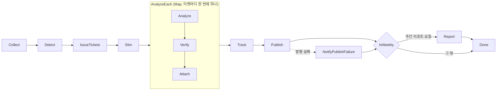

# aws/statemachine — 하루 배치 순서 (Step Functions)

매일 한 번 도는 배치의 **순서와 실패 처리**를 정의한 Step Functions 상태 머신(ASL) 한 파일이 있습니다. lab 의 `simulate.py` · `next_day.py`, skeleton 의 `daily` 에 해당합니다.

## 파일

| 파일 | 역할 | 언제 보나 |
|---|---|---|
| `daily.asl.json` | 상태 머신 `slowq-daily` 의 정의. `${…}` 자리는 Terraform(`terraform/stepfunctions.tf`)이 Lambda ARN 등으로 채움 | 순서 · 재시도 · 실패 경로를 볼 때 |

흐름 (상태 이름 그대로):



- Collect · Detect · IssueTickets · Track · Report 가 실패하면 `NotifyFailure`(SNS 알림) → `Failed` 로 끝납니다.
- 발행(Publish) 실패는 알리기만 하고 리포트 단계는 계속합니다.
- Map 안에서 한 티켓의 분석 · 검증 · 첨부가 실패하면 그 티켓만 「사람 검토」로 남기고 다음 티켓으로 넘어갑니다.

## 준비물

- [terraform/README.md](../terraform/README.md) 로 배포 완료, 그리고 `slowq-init-db` 를 한 번 실행한 상태 ([lambda/README.md](../lambda/README.md) 3단계)
- AWS CLI v2

## 따라 하기

`aws/terraform` 폴더에서 치면 `terraform output` 으로 ARN 을 바로 꺼낼 수 있습니다.

1. **첫 실행 = 기준 스냅숏** (수집기가 누적값의 기준만 남김)

   ```bash
   cd aws/terraform
   aws stepfunctions start-execution \
     --state-machine-arn "$(terraform output -raw state_machine_arn)" --input '{}'
   ```

   ```
   {
       "executionArn": "arn:aws:states:<리전>:<계정>:execution:slowq-daily:…",
       "startDate": "…"
   }
   ```

2. **끝났는지 보기** — 위에서 받은 `executionArn` 으로:

   ```bash
   aws stepfunctions describe-execution --execution-arn <executionArn> --query status --output text
   ```

   `RUNNING` → `SUCCEEDED` 가 되면 정상입니다. `FAILED` 면 콘솔의 Step Functions 실행 그래프에서 빨간 상태를 눌러 오류를 봅니다.

3. **부하를 준 뒤 하루치 실행** — 입력에 날짜를 주면 그 날로, `{}` 이면 `schedule_timezone` 기준 **어제**로 집계합니다.

   ```bash
   aws lambda invoke --function-name slowq-workload --cli-read-timeout 910 \
     --payload '{"scale": 1.0}' --cli-binary-format raw-in-base64-out /dev/stdout
   aws stepfunctions start-execution \
     --state-machine-arn "$(terraform output -raw state_machine_arn)" --input '{"log_date": "2026-10-14"}'
   ```

   이번에는 Collect 뒤에 검출 · 티켓 · 분석까지 돕니다. `log_date` 의 요일이 `report_weekday`(기본 6 = 일요일)이면 Report 까지 갑니다.

4. **매일 자동 실행 켜기** — 확인이 끝나면 `terraform.tfvars` 에 `schedule_enabled = true` 를 넣고 `terraform apply`. 기본 일정은 `cron(10 0 * * ? *)`(매일 00:10, `Asia/Seoul`)입니다.

## 자주 막히는 곳

| 증상 | 원인 · 해결 |
|---|---|
| 첫 실행 뒤 티켓이 하나도 없다 | 정상입니다. 첫 수집은 기준 스냅숏만 남깁니다. 부하 → 다음 실행부터 차이가 쌓입니다 |
| 두 번째 실행에도 티켓이 없다 | 부하가 적거나 규칙이 엄격합니다(`rules` 기본 0.5초 · 30회). 부하를 더 주거나 [terraform/README.md](../terraform/README.md) 의 `rules` 를 낮춥니다 |
| `Collect` 에서 실패 · `모든 클러스터 수집 실패` | `init-db` 를 안 했거나 실패했습니다. [lambda/README.md](../lambda/README.md) 3단계 |
| `InvalidExecutionInput` · 날짜 형식 오류 | `--input` 은 JSON 이고 날짜는 `YYYY-MM-DD` 입니다 |
| 정의를 고쳤는데 반영이 안 된다 | `daily.asl.json` 수정 뒤 `terraform apply` 가 필요합니다. 고친 뒤 `aws` 에서 `scripts/validate.sh` 로 구조 검사 |

## 다음 단계

- 리포트 · 계획서 확인과 Grafana: [aws/README.md](../README.md) 4~5장, [grafana/README.md](../grafana/README.md)
- 각 상태가 부르는 함수: [lambda/README.md](../lambda/README.md)
- 전체 순서도: [docs/GETTING_STARTED.md](../../docs/GETTING_STARTED.md)
