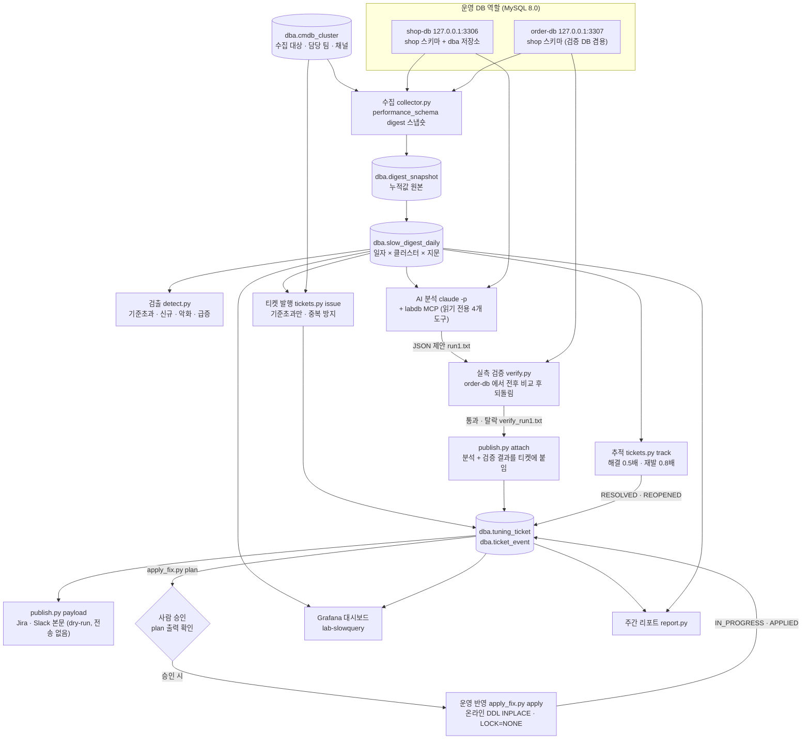
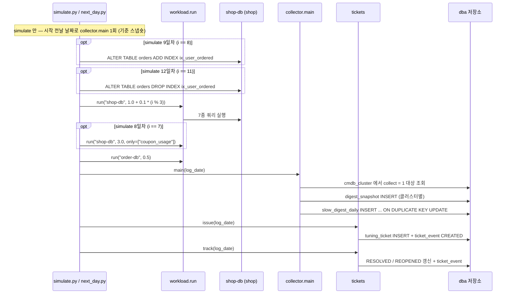
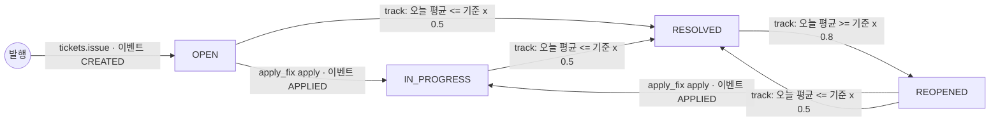
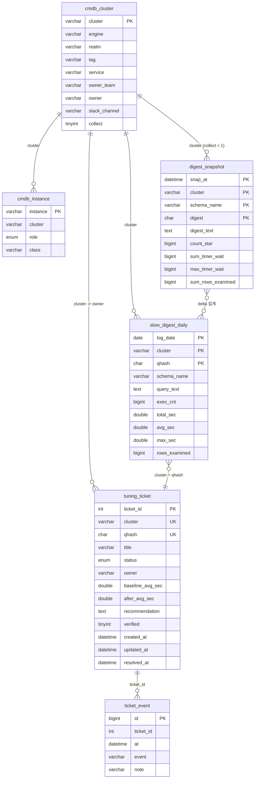

# 00. 흐름도

이 저장소의 슬로우 쿼리 자동화가 **어떤 순서로, 어떤 테이블을 거쳐** 움직이는지 한눈에 봅니다.
각 단계의 상세는 문서 끝의 링크를 따라갑니다.

## 1. 전체 구조

- 저장소(`dba`)는 shop-db 에 있습니다 — [common.py:9](../lab/scripts/common.py#L9) `STORE = "shop-db"`.
- 검증 DB 는 order-db(3307)입니다 — [verify.py:10](../lab/ai/verify.py#L10). 두 서버 모두 같은 초기화 SQL 로 같은 `shop` 데이터를 갖습니다([docker-compose.yml:12](../lab/docker-compose.yml#L12), [docker-compose.yml:23](../lab/docker-compose.yml#L23)).
- **사람 승인 단계**: 코드에 승인 버튼이 있는 것은 아닙니다. `apply_fix.py plan` 은 아무것도 바꾸지 않고 변경 계획만 출력하고([apply_fix.py:3](../lab/scripts/apply_fix.py#L3)), 사람이 그 내용을 보고 `apply` 를 직접 실행하는 흐름입니다. 실측 검증을 통과하지 못한 제안은 계획 자체를 만들지 않습니다([apply_fix.py:20-21](../lab/scripts/apply_fix.py#L20)).
- `detect.py` 는 검출 결과를 **출력만** 합니다. 티켓 발행은 `tickets.py issue` 가 자체 조건(기준초과와 같은 조건)으로 따로 수행합니다([tickets.py:28](../lab/scripts/tickets.py#L28)). 스켈레톤은 검출 결과를 발행에 그대로 넘깁니다([cli.py:36-38](../skeleton/slowq/cli.py#L36)).
- Jira · Slack 은 **본문을 출력만 하는 dry-run** 입니다([publish.py:79](../lab/scripts/publish.py#L79)). 실제 전송 코드는 없습니다.

## 2. 하루 배치 순서 (simulate · next_day)

`simulate.py` 는 14일을, `next_day.py` 는 하루를 같은 순서로 돌립니다.

근거 코드:

| 순서 | simulate.py | next_day.py |
|---|---|---|
| 기준 스냅숏 | [simulate.py:24](../lab/scripts/simulate.py#L24) | 없음 (이미 기준이 있다고 가정) |
| 인덱스 추가 · 삭제 | [simulate.py:27-30](../lab/scripts/simulate.py#L27) | 없음 |
| 부하 | [simulate.py:31-34](../lab/scripts/simulate.py#L31) | [next_day.py:12-13](../lab/scripts/next_day.py#L12) (shop-db 1.0 고정) |
| 수집 → 발행 → 추적 | [simulate.py:35-37](../lab/scripts/simulate.py#L35) | [next_day.py:14-16](../lab/scripts/next_day.py#L14) |

스켈레톤의 `daily` 는 **수집 → 검출 → 발행(dry-run) → 추적** 순서입니다([cli.py:25-42](../skeleton/slowq/cli.py#L25)).

## 3. 티켓 상태 머신

상태 값은 `ENUM('OPEN','IN_PROGRESS','RESOLVED','REOPENED')` 네 가지뿐입니다([02_dba.sql:41](../lab/mysql/init/02_dba.sql#L41)).

| 전이 | 조건 | 코드 |
|---|---|---|
| (없음) → OPEN | 기준초과 + 같은 (cluster, qhash) 티켓 없음 | [tickets.py:28](../lab/scripts/tickets.py#L28), [tickets.py:34-39](../lab/scripts/tickets.py#L34) |
| OPEN · IN_PROGRESS · REOPENED → RESOLVED | 그날 평균 ≤ 기준 × 0.5 | [tickets.py:53-56](../lab/scripts/tickets.py#L53) |
| RESOLVED → REOPENED | 그날 평균 ≥ 기준 × 0.8 | [tickets.py:58-60](../lab/scripts/tickets.py#L58) |
| OPEN · IN_PROGRESS · REOPENED → IN_PROGRESS | 운영 반영 성공 | [apply_fix.py:36-38](../lab/scripts/apply_fix.py#L36), [apply_fix.py:141-143](../lab/scripts/apply_fix.py#L141) |

- 0.5 와 0.8 사이에서는 상태가 바뀌지 않습니다(흔들림 방지). 스켈레톤은 그날 실행이 없으면(`now is None`) 판단을 보류합니다([skeleton tickets.py:8-15](../skeleton/slowq/tickets.py#L8)).
- `AI_ANALYZED` 이벤트는 상태를 바꾸지 않는 기록입니다([publish.py:41-44](../lab/scripts/publish.py#L41)).
- 이벤트 이름 목록: `CREATED` · `AI_ANALYZED` · `APPLIED` · `RESOLVED` · `REOPENED`. 주간 리포트는 이 중 4개를 상태로 되짚습니다([report.py:9](../lab/scripts/report.py#L9)).

## 4. 저장소 테이블 관계 (dba)

DDL 에 외래 키는 없습니다. 아래 관계는 코드가 조인하는 **논리적 키**입니다.

DDL: [02_dba.sql:6-87](../lab/mysql/init/02_dba.sql#L6). 스켈레톤 스키마는 [schema.sql](../skeleton/schema.sql) 로, `cmdb_cluster` 에 `host` · `port` 가 있고 `slow_digest_daily` 에 `schema_name` · `max_sec` 이, `tuning_ticket` 에 `verified` · `updated_at` 이 없습니다.

## 5. lab 과 skeleton 대응

| 단계 | lab (실습 예제) | skeleton (내 환경용) | 차이 |
|---|---|---|---|
| 설정 · 접속 | [common.py](../lab/scripts/common.py) (포트 · 계정 고정) | [config.py](../skeleton/slowq/config.py) · [db.py](../skeleton/slowq/db.py) · [config.example.ini](../skeleton/config.example.ini) | 비밀번호는 환경 변수로만 |
| 저장소 스키마 | [02_dba.sql](../lab/mysql/init/02_dba.sql) | [schema.sql](../skeleton/schema.sql) | CMDB 에 host · port |
| 수집 | [collector.py](../lab/scripts/collector.py) | [collect.py](../skeleton/slowq/collect.py) | FIRST_SEEN 재시작 감지, 첫 실행은 기준만 |
| 검출 | [detect.py](../lab/scripts/detect.py) (출력 전용) | [detect.py](../skeleton/slowq/detect.py) (발행 입력) | 신규는 이력 있는 클러스터만 |
| 마스킹 | [mask.py](../lab/scripts/mask.py) | [mask.py](../skeleton/slowq/mask.py) | 패턴 동일 |
| 발행 · 추적 | [tickets.py](../lab/scripts/tickets.py) | [tickets.py](../skeleton/slowq/tickets.py) | 상한은 신규 발행분만 셈 |
| 알림 | [publish.py](../lab/scripts/publish.py) payload (dry-run) | [publish.py](../skeleton/slowq/publish.py) `DryRunPublisher` | 둘 다 전송 없음 |
| AI 분석 | `claude -p` (lab/ai 에서 수동) | [analyze.py](../skeleton/slowq/analyze.py) (선택, `daily` 에 미연결) | 엄격 JSON 파싱 |
| 실측 검증 | [verify.py](../lab/ai/verify.py) | [verify.py](../skeleton/slowq/verify.py) (선택, `daily` 에 미연결) | 결과 비교 시 행 순서 무시 |
| 운영 반영 | [apply_fix.py](../lab/scripts/apply_fix.py) | 없음 | skeleton README 의 이식 표 참고 |
| 리포트 | [report.py](../lab/scripts/report.py) | 없음 | 〃 |
| 대시보드 | [make_dashboard.py](../lab/grafana/make_dashboard.py) | 없음 | 〃 |
| 일괄 실행 | [simulate.py](../lab/scripts/simulate.py) · [next_day.py](../lab/scripts/next_day.py) | [cli.py](../skeleton/slowq/cli.py) `daily` | 클러스터 단위 실패 격리, 실패 시 종료 코드 1 |

이식 시 바꿀 고정값은 [skeleton/README.md](../skeleton/README.md) 5장 표에 정리돼 있습니다.

## 다음 단계

- [01. 데이터베이스 설정](01-database-setup.md)
- 단계별 상세: [06 수집](06-collection.md) → [07 집계](07-aggregation.md) → [08 진단](08-diagnosis.md) → [09 티켓](09-ticket.md) → [10 추적 · 자동화](10-tracking-automation.md)
