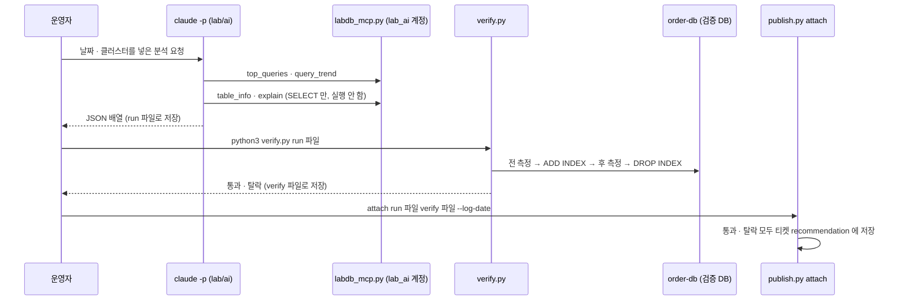

# 08. 진단 (AI 분석 + 실측 검증)

## 목적

검출된 슬로우 쿼리의 원인과 개선안을 **Claude Code** 가 찾게 하되, AI 는 **읽기 전용 도구 4개**만 쓰고 운영을 바꾸지 못하게 합니다. AI 의 제안은 "예상"일 뿐이므로, **검증 DB 에서 실제로 전후를 재서** 통과한 것만 반영 후보로 넘깁니다.



## 관련 파일

| 파일 | 내용 |
|---|---|
| [lab/ai/CLAUDE.md](../lab/ai/CLAUDE.md) | 분석 규칙 · 출력 형식 (claude 가 작업 폴더에서 읽음) |
| [lab/ai/labdb_mcp.py](../lab/ai/labdb_mcp.py) | 읽기 전용 MCP 서버 `labdb` (도구 4개) |
| [lab/ai/mcp.json](../lab/ai/mcp.json) | MCP 서버 실행 설정 |
| [lab/ai/verify.py](../lab/ai/verify.py) | 실측 검증 |
| [lab/ai/run1.txt](../lab/ai/run1.txt) · [verify_run1.txt](../lab/ai/verify_run1.txt) | 동봉된 분석 · 검증 결과 예 (`run2.txt` · `run3.txt` 는 다른 실행의 결과 예) |
| [lab/scripts/publish.py](../lab/scripts/publish.py) | `attach` — 결과를 티켓에 붙임 |
| [skeleton/slowq/analyze.py](../skeleton/slowq/analyze.py) · [skeleton/slowq/verify.py](../skeleton/slowq/verify.py) | 스켈레톤 버전 (선택 모듈) |

## 동작 상세

### 1) Claude Code 호출

스켈레톤이 만드는 명령([analyze.py:23-26](../skeleton/slowq/analyze.py#L23)):

```python
["claude", "-p", prompt, "--mcp-config", mcp_config, "--strict-mcp-config", "--tools", "",
 *(["--allowedTools", *tools] if tools else []), "--output-format", "text"]
```

| 옵션 | 뜻 |
|---|---|
| `-p` | 비대화형 1회 실행 |
| `--mcp-config mcp.json` | `labdb` MCP 서버만 띄움 |
| `--strict-mcp-config` | 다른 곳에 설정된 MCP 서버는 쓰지 않음 |
| `--tools ""` | 기본 도구(Read · Bash 등)를 **모두 끔** |
| `--allowedTools <도구...>` | 지정한 MCP 도구는 묻지 않고 실행 (도구 이름 형식 `mcp__labdb__explain` — [test_unit.py:197](../skeleton/tests/test_unit.py#L197)) |

`--allowedTools` 는 허용 목록이 아니라 "묻지 않음" 목록이라, 기본 도구는 `--tools ""` 로 따로 꺼야 합니다(테스트 주석 [test_unit.py:193](../skeleton/tests/test_unit.py#L193)). `run_claude` 는 작업 폴더(`cwd`)에서 실행해 그 폴더의 `CLAUDE.md` · `mcp.json` 을 쓰고, 입력은 `/dev/null`, 기본 제한 시간 900초, 실패 시 예외를 냅니다([analyze.py:29-35](../skeleton/slowq/analyze.py#L29)).

lab 에서는 `lab/ai` 폴더에서 직접 실행합니다(상대 경로 `../.venv/bin/python` 이 맞도록 — [mcp.json](../lab/ai/mcp.json)). 실행 예 (요청 문장은 예시입니다):

```bash
cd lab/ai
claude -p "<날짜> shop-db 슬로우 쿼리 상위를 분석해 줘" \
  --mcp-config mcp.json --strict-mcp-config --tools "" \
  --allowedTools mcp__labdb__top_queries mcp__labdb__table_info mcp__labdb__explain mcp__labdb__query_trend \
  --output-format text > run_my.txt < /dev/null
```

동봉된 `run1.txt` · `verify_run1.txt` 는 덮어쓰지 말고 다른 이름으로 저장합니다([lab/README.md](../lab/README.md) 3장).

### 2) CLAUDE.md 규칙

[lab/ai/CLAUDE.md](../lab/ai/CLAUDE.md) 의 "반드시 지킬 것" 7가지:

1. 근거 없이 단정하지 않는다 — explain · table_info 수치를 그대로 인용, 없으면 "확인 필요".
2. 운영을 바꾸지 않는다 — DDL 실행 금지, 제안만.
3. 기존 인덱스를 먼저 본다 — 겹치는 인덱스 제안 금지.
4. 인덱스를 못 타는 7가지 패턴 점검(컬럼 함수 · 형 변환 · 앞쪽 % LIKE · 선두 컬럼 누락 · 컬럼 연산 · 한쪽만 인덱스인 OR · 선택도 낮은 컬럼).
5. 복합 인덱스는 같다(=) 조건 → 정렬 · 범위 순서.
6. 예상 효과는 "예상" — 실측 검증 전에는 확정하지 않는다.
7. 값(?) 자리에는 테스트 값을 넣어 explain, 운영 값을 추측하지 않는다.

**출력 형식**: 쿼리마다 객체 하나, 전체를 JSON 배열 하나로.

```json
{"qhash": "...", "cause": "원인 한 문장", "evidence": ["근거 수치 1", "근거 2"],
 "proposal": "ALTER TABLE ... 또는 쿼리 재작성", "expected": "예상 효과", "confidence": "high|medium|low",
 "verify": "실측 검증에서 확인할 것"}
```

### 3) MCP 도구 4개와 읽기 전용 계정

서버 이름 `labdb`, 계정 `lab_ai` / `lab-ai-pw` ([labdb_mcp.py:16-19](../lab/ai/labdb_mcp.py#L16)). 이 계정은 `shop.*` SELECT 와 `dba.slow_digest_daily` SELECT 만 갖습니다([02_dba.sql:99-101](../lab/mysql/init/02_dba.sql#L99)) — 코드가 잘못돼도 DB 권한이 막습니다.

| 도구 | 하는 일 | 안전장치 | 줄 |
|---|---|---|---|
| `top_queries(log_date, cluster, limit)` | 그날 총 부하 순 상위 지문 (저장소 `slow_digest_daily`) | 저장소는 항상 shop-db 에서 읽음 | [L32-38](../lab/ai/labdb_mcp.py#L32) |
| `table_info(table, cluster)` | `SHOW CREATE TABLE` · `SHOW INDEX` · 대략 행 수 (`shop` 스키마) | 테이블 이름은 `[A-Za-z0-9_]+` 만 | [L41-50](../lab/ai/labdb_mcp.py#L41) |
| `explain(sql, cluster)` | `EXPLAIN FORMAT=TREE` (실행하지 않음) | `SELECT` 한 문장만, `;` · `INTO OUTFILE` · `FOR UPDATE` · `SLEEP(` 거부, 계획 속 문자열 값 마스킹 | [L53-60](../lab/ai/labdb_mcp.py#L53) |
| `query_trend(qhash, cluster)` | 지문 하나의 일자별 횟수 · 평균 · 총 부하 | | [L63-66](../lab/ai/labdb_mcp.py#L63) |

클러스터 이름은 `shop-db` · `order-db` 만 허용합니다([L22-24](../lab/ai/labdb_mcp.py#L22)). 실행은 `server.run("stdio")` ([L69-70](../lab/ai/labdb_mcp.py#L69)), 의존성은 `mcp==2.3.0` ([requirements.txt:4](../lab/requirements.txt#L4)).

### 4) verify.py — 실측 검증

[lab/ai/verify.py](../lab/ai/verify.py). 검증 DB 는 order-db(3307), root, `shop` ([L10](../lab/ai/verify.py#L10)) — 운영(shop-db)에는 손대지 않습니다.

1. AI 출력에서 첫 `[` ~ 마지막 `]` 를 JSON 으로 읽습니다. 형식이 틀리면 **아무것도 검증하지 않고 멈춥니다**([L42-46](../lab/ai/verify.py#L42)).
2. 제안마다 `TEST_SQL` 에서 지문별 테스트 쿼리를 찾습니다(실습용으로 3개 지문 고정 — [L12-19](../lab/ai/verify.py#L12)). 없으면 건너뜀.
3. 제안 문장에서 첫 `ALTER TABLE` 을 꺼내 **`ADD INDEX` 한 절만 있는지** 검사하고, 원문이 아니라 검사한 절로 DDL 을 다시 만듭니다. 다른 절이 붙으면 되돌릴 수 없으므로 건너뜁니다([L21-27](../lab/ai/verify.py#L21), [L53-55](../lab/ai/verify.py#L53)).
4. 전 측정 → `ADD INDEX` → 후 측정 → `finally` 에서 **반드시 `DROP INDEX`** ([L57-62](../lab/ai/verify.py#L57)).
   측정은 3회 중 최소 시간, 결과 행의 md5(결과 동일성), `EXPLAIN ANALYZE` 마지막 줄([L30-38](../lab/ai/verify.py#L30)).
5. 판정: **결과가 같고 후 시간 ≤ 전 시간 × 0.5** 이면 `통과`, 아니면 `탈락` ([L20](../lab/ai/verify.py#L20), [L63-64](../lab/ai/verify.py#L63)).

스켈레톤 `verify()` 는 같은 원리이고, 결과 비교 시 **행 순서를 무시**하며(인덱스가 생기면 ORDER BY 없는 결과 순서가 바뀔 수 있음) dict 를 돌려줍니다([skeleton verify.py:17-19](../skeleton/slowq/verify.py#L17), [L34-47](../skeleton/slowq/verify.py#L34)). 스켈레톤 `analyze` · `verify` 는 `daily` 에 연결돼 있지 않은 선택 모듈입니다([skeleton/README.md](../skeleton/README.md) 5장).

### 5) 결과를 티켓에 붙이기 (publish.py attach)

[publish.py:13-45](../lab/scripts/publish.py#L13).

- `verify` 출력에서 `[xxxxxxxx] 통과|탈락` 줄과 그 아래 `시간 …` 줄을 읽습니다([L13-22](../lab/scripts/publish.py#L13)).
- 제안마다 shop-db 의 같은 `qhash` 티켓을 찾고, 없으면 `티켓 없음 (발행 기준 미달) — 붙이지 않음` ([L32-35](../lab/scripts/publish.py#L32)).
- **통과든 탈락이든 모두** `recommendation` 에 JSON(`cause` · `evidence` · `proposal` · `confidence` · `verify`)으로 저장합니다([L36-39](../lab/scripts/publish.py#L36)). 결과 표시는 `실측 통과` / `실측 탈락 → 사람 검토` / `검증 없음` ([L40](../lab/scripts/publish.py#L40)).
- `AI_ANALYZED` 이벤트를 `<log_date> 10:00:00` 으로 남기되, 다시 실행해도 한 번만 들어가게 `NOT EXISTS` 로 막습니다([L41-44](../lab/scripts/publish.py#L41)).
- 이후 **운영 반영 계획은 `verify.pass` 가 참인 제안만** 만듭니다([apply_fix.py:19-21](../lab/scripts/apply_fix.py#L19), [10 문서](10-tracking-automation.md)).

### 6) 동봉 결과 예

`run1.txt` 는 shop-db 상위 3개 지문에 대한 제안입니다.

| qhash | 원인 (요약) | 제안 | confidence |
|---|---|---|---|
| `5e9245c3` | `user_id` 인덱스 없음 → 전체 스캔 + 정렬 ([run1.txt:5](../lab/ai/run1.txt#L5)) | `ADD INDEX ix_orders_user_ordered (user_id, ordered_at)` ([L13](../lab/ai/run1.txt#L13)) | high |
| `f54ce51c` | 정렬 인덱스 없음 + 깊은 OFFSET ([L20](../lab/ai/run1.txt#L20)) | `(ordered_at, order_id)` 인덱스 + 키셋 페이징 ([L28](../lab/ai/run1.txt#L28)) | medium |
| `60cd58c2` | `coupon_code` 인덱스 없음 ([L35](../lab/ai/run1.txt#L35)) | 커버링 `(coupon_code, amount)` ([L43](../lab/ai/run1.txt#L43)) | medium |

`verify_run1.txt` 결과:

```
[5e9245c3] 통과  ALTER TABLE orders ADD INDEX ix_orders_user_ordered (user_id, ordered_at)
    시간 261.5 ms → 0.15 ms (1785배) · 결과 동일 True
[f54ce51c] 탈락  ALTER TABLE orders ADD INDEX ix_orders_ordered (ordered_at, order_id)
    시간 524.2 ms → 529.10 ms (1배) · 결과 동일 True
[60cd58c2] 통과  ALTER TABLE orders ADD INDEX ix_orders_coupon_amount (coupon_code, amount)
    시간 175.6 ms → 0.18 ms (1002배) · 결과 동일 True
```

(전 · 후 실행 계획 줄은 생략 — [verify_run1.txt](../lab/ai/verify_run1.txt).) 두 번째 제안은 인덱스를 추가해도 깊은 OFFSET 에서 `Table scan` 이 그대로라 탈락했고([verify_run1.txt:8](../lab/ai/verify_run1.txt#L8)), 티켓에는 "사람 검토"로 붙습니다. 키셋 페이징 같은 **쿼리 재작성 제안은 verify 가 자동 검증하지 않습니다**(ADD INDEX 한 절만 검증).

## 실행 방법

```bash
cd lab/ai
claude -p "..." --mcp-config mcp.json ... > run_my.txt < /dev/null   # 위 1) 참고
../.venv/bin/python verify.py run_my.txt > verify_my.txt
cd ../scripts
../.venv/bin/python publish.py attach ../ai/run_my.txt ../ai/verify_my.txt --log-date <날짜>
```

동봉 결과로 해 보려면 `publish.py attach ../ai/run1.txt ../ai/verify_run1.txt --log-date <마지막 날>`.

## 확인 방법

- `verify.py` 가 `[xxxxxxxx] 통과|탈락` 과 `시간 … ms → … ms` 를 출력하면 정상. JSON 이 아니면 `AI 출력이 올바른 JSON 배열이 아닙니다 → 검증 중단` 으로 멈춥니다.
- 검증 후 검증 DB 에 인덱스가 남지 않아야 합니다: `SELECT index_name FROM information_schema.statistics WHERE table_schema='shop' AND table_name='orders';` (3307). 중간에 끊겨 남았으면 `sqlrun.py --port 3307 --keep-going < sql/reset.sql` ([reset.sql:20-22](../lab/sql/reset.sql#L20)).
- `attach` 출력 `#1 [5e9245c3] 실측 통과` 형식, 그리고 `SELECT recommendation FROM dba.tuning_ticket WHERE ticket_id=…;` 에 JSON 이 들어 있으면 정상.

## 주의 · 운영 팁

- 검증 DB 는 운영과 같은 데이터의 복제본 · 스냅숏 복원본이어야 합니다. 운영 DB 에서 verify 를 돌리지 않습니다(DDL 을 실제로 실행합니다).
- `TEST_SQL` 은 실습용으로 지문 3개가 고정돼 있습니다. 내 환경에서는 지문별 테스트 쿼리(테스트 값 포함)를 마련하는 절차가 필요합니다.
- AI 결과는 실행마다 다를 수 있습니다(`run1` · `run2` · `run3` 비교). 그래서 형식 검사와 실측 검증을 사람 판단 앞에 둡니다.

## 다음 단계

→ [09. 티켓 발행](09-ticket.md)
