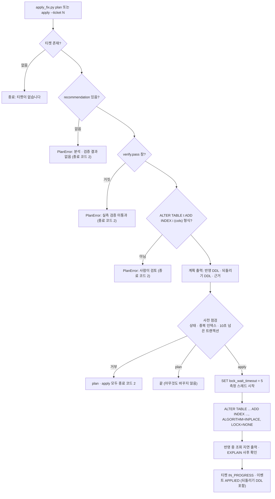

# 10. 성능 추적 관리 자동화

## 목적

티켓을 연 뒤의 일을 숫자로 자동 판정합니다. 매일 수집된 평균을 티켓 기준값과 비교해 **해결(RESOLVED)과 재발(REOPENED)** 을 기록하고, 실측 검증을 통과한 제안만 **안전장치를 건 온라인 DDL** 로 반영하며, 주간 리포트로 결과를 정리합니다.

## 관련 파일

| 파일 | 내용 |
|---|---|
| [lab/scripts/tickets.py](../lab/scripts/tickets.py) | `track` — 해결 · 재발 판정 |
| [lab/scripts/apply_fix.py](../lab/scripts/apply_fix.py) | 운영 반영 `plan` · `apply` |
| [lab/scripts/next_day.py](../lab/scripts/next_day.py) | 하루 진행 (부하 → 수집 → 발행 → 추적) |
| [lab/scripts/report.py](../lab/scripts/report.py) | 주간 리포트 |
| [lab/tests/test_ops.py](../lab/tests/test_ops.py) | 반영 · 리포트 · 검증 DDL 테스트 |
| [skeleton/slowq/cli.py](../skeleton/slowq/cli.py) | `python -m slowq daily` |
| [skeleton/slowq/tickets.py](../skeleton/slowq/tickets.py) | `next_status` · `track` |

## 동작 상세

### 1) 해결 · 재발 판정 (tickets.track)

```python
if r["status"] in ("OPEN", "IN_PROGRESS", "REOPENED") and now <= base * RESOLVE_RATIO:   # 0.5
    -> RESOLVED, after_avg_sec = now, verified = 1, resolved_at = <log_date> 09:00:00, 이벤트 RESOLVED
elif r["status"] == "RESOLVED" and now >= base * REOPEN_RATIO:                          # 0.8
    -> REOPENED, 이벤트 REOPENED
```

[tickets.py:44-61](../lab/scripts/tickets.py#L44), 상수 [tickets.py:12-13](../lab/scripts/tickets.py#L12).

- `base` 는 발행일 평균(`baseline_avg_sec`), `now` 는 그날 `slow_digest_daily.avg_sec` 입니다. **그날 실행 기록이 있는 티켓만** 판정합니다(INNER JOIN — [L47-49](../lab/scripts/tickets.py#L47)).
- 0.5 와 0.8 사이는 상태를 유지합니다 — 판정이 날마다 흔들리지 않게 하는 간격입니다.
- REOPENED 가 돼도 `baseline_avg_sec` 은 처음 값 그대로이므로 다시 0.5배 이하가 되면 RESOLVED 로 갑니다.
- 스켈레톤은 같은 비율을 `next_status()` 로 분리했고, LEFT JOIN 으로 그날 실행이 없으면(`None`) 보류합니다. `verified` 컬럼은 없고, 이벤트 이름은 새 상태 이름입니다([skeleton tickets.py:8-15](../skeleton/slowq/tickets.py#L8), [L54-73](../skeleton/slowq/tickets.py#L54)).

### 2) 운영 반영 (apply_fix.py)



**계획 만들기** — `build_plan` ([apply_fix.py:16-29](../lab/scripts/apply_fix.py#L16)):
- `recommendation` 이 없으면 "AI 분석 · 검증 결과가 없습니다", `verify.pass` 가 아니면 "실측 검증을 통과하지 않은 제안입니다", `ADD INDEX` 형식이 아니면 "사람이 검토합니다" 로 거부합니다.
- 반영 DDL: `ALTER TABLE <t> ADD INDEX <i> (<cols>), ALGORITHM=INPLACE, LOCK=NONE` — 쓰기를 막지 않는 온라인 DDL ([L27](../lab/scripts/apply_fix.py#L27)).
- 되돌리기 DDL: `ALTER TABLE <t> DROP INDEX <i>` ([L28](../lab/scripts/apply_fix.py#L28)). **자동으로 실행하지 않고** 계획 출력과 `APPLIED` 이벤트 note 에 남깁니다.

**사전 점검** — `show_plan` ([apply_fix.py:80-97](../lab/scripts/apply_fix.py#L80)):

| 점검 | 기준 | 코드 |
|---|---|---|
| 티켓 상태 | `OPEN` · `IN_PROGRESS` · `REOPENED` 만 (해결된 티켓에 다시 반영하지 않음) | [L36-38](../lab/scripts/apply_fix.py#L36) |
| 중복 인덱스 | 이름이 같거나 **컬럼 조합이 같은** 인덱스가 있으면 거부 (`information_schema.statistics`, 대문자 열 이름 대응) | [L41-47](../lab/scripts/apply_fix.py#L41), [L66-71](../lab/scripts/apply_fix.py#L66) |
| 긴 트랜잭션 | `innodb_trx` 에서 **10초** 넘게 열린 트랜잭션이 있으면 거부 — 온라인 DDL 도 시작 · 끝에 메타데이터 락을 잡기 때문 | [L32](../lab/scripts/apply_fix.py#L32), [L50-63](../lab/scripts/apply_fix.py#L50) |
| 테이블 크기 | 대략 MB 를 출력 (판단 참고용) | [L61-63](../lab/scripts/apply_fix.py#L61) |

`plan` 에서 거부되면 종료 코드 **2** ([L159-160](../lab/scripts/apply_fix.py#L159)), `apply` 중 `PlanError` 도 종료 코드 2 ([L165-167](../lab/scripts/apply_fix.py#L165)).

**반영** — `apply` / `_apply` ([apply_fix.py:100-144](../lab/scripts/apply_fix.py#L100)):
1. 상태 · 중복 · 긴 트랜잭션을 **다시** 점검합니다(계획과 반영 사이의 변화 대비).
2. `SET SESSION lock_wait_timeout = 5` — 메타데이터 락을 5초 넘게 기다리면 DDL 을 취소합니다(오래 기다리며 뒤의 조회를 막느니 취소) ([L33](../lab/scripts/apply_fix.py#L33), [L125](../lab/scripts/apply_fix.py#L125)).
3. 다른 세션에서 PK 조회를 반복하는 측정 스레드를 띄우고 DDL 을 실행합니다. DDL 이 실패해도 `finally` 에서 측정을 멈추고 오류를 그대로 올립니다([L116-131](../lab/scripts/apply_fix.py#L116)).
4. `반영 완료 : N초`, `반영 중 조회 N회 · 중앙값 · 최대 ms` 출력 후, `EXPLAIN FORMAT=TREE` 로 사후 확인 한 줄을 출력합니다([L132-139](../lab/scripts/apply_fix.py#L132)).
5. 티켓을 `IN_PROGRESS` 로 바꾸고 `APPLIED` 이벤트(`<log_date> 08:00:00`, note 에 반영 DDL · 소요 시간 · 되돌리기 DDL)를 남깁니다([L140-144](../lab/scripts/apply_fix.py#L140)). 해결 여부는 **다음 날 `track`** 이 판정합니다.

> 사후 확인 쿼리(`orders` · `user_id = 1001`)와 측정 쿼리(`orders` · `order_id`)는 실습 사례에 고정돼 있고, 반영 계정은 root 입니다([L117-121](../lab/scripts/apply_fix.py#L117), [L137-138](../lab/scripts/apply_fix.py#L137)). 내 환경으로 옮길 때 반드시 바꿉니다([skeleton/README.md](../skeleton/README.md) 5장).

### 3) next_day.py

반영 다음 날을 진행합니다: shop-db 부하(1.0) → order-db 부하(0.5) → 수집 → 발행 → 추적([next_day.py:12-16](../lab/scripts/next_day.py#L12)). 반영한 인덱스로 평균이 기준의 절반 이하가 되면 이 단계에서 RESOLVED 로 바뀝니다.

### 4) 주간 리포트 (report.py)

[report.py:21-73](../lab/scripts/report.py#L21). 기간은 `--end` 포함 최근 `--days`(기본 7)일.

| 항목 | 계산 |
|---|---|
| 새 티켓 | 기간 안에 `created_at` 이 있는 티켓 수 |
| 해결 · 재발 | 기간 안에 `RESOLVED` · `REOPENED` 이벤트가 있는 **티켓 수** (같은 티켓 두 번이어도 1건) |
| 열린 티켓 | `end` 시점 상태가 `OPEN` · `IN_PROGRESS` · `REOPENED` 인 티켓 수 |
| 절감 시간 | 기간 안의 일자 중 평균이 기준의 0.5배 이하인 날의 `(기준 - 실제) × 실행 횟수` 합 |
| 팀별 열린 티켓 | CMDB `owner_team` 별 개수 |
| 열린 티켓 목록 | 오래된 순: 번호 · 클러스터 · qhash · 상태 · 경과 일수 · 기준 → `end` 일 평균 · 하루 부하 · 팀 |

`end` 시점 상태는 **이벤트를 시간순으로 되짚어** 구합니다(`CREATED→OPEN`, `APPLIED→IN_PROGRESS`, `RESOLVED`, `REOPENED`) — 지난 주 리포트를 다시 뽑아도 그때 숫자가 나오게 하기 위해서입니다([report.py:9-18](../lab/scripts/report.py#L9)). 이 동작은 테스트로 고정돼 있습니다([test_ops.py:85-116](../lab/tests/test_ops.py#L85)).

### 5) 스켈레톤 `python -m slowq daily`

[cli.py:21-48](../skeleton/slowq/cli.py#L21): CMDB `collect = 1` 대상마다 수집(클러스터별 예외 격리) → `detect.run` → `tickets.issue`(top_n) → `DryRunPublisher` → `tickets.track` → 요약 출력. 수집 실패 클러스터가 하나라도 있으면 **종료 코드 1** 로 스케줄러가 실패를 알게 합니다([cli.py:67-68](../skeleton/slowq/cli.py#L67)). 스켈레톤 범위는 수집 → 검출 → 발행 → 추적이며, 반영(`apply_fix.py`) · 리포트(`report.py`)는 lab 에서 가져와 붙입니다.

## 실행 방법

사례 실습 순서(`lab` 에서, 날짜는 simulate 대응표의 내 날짜 — [lab/README.md](../lab/README.md) 5장):

```bash
.venv/bin/python scripts/report.py --end <마지막 날>                    # 반영 전 주간 리포트
.venv/bin/python scripts/apply_fix.py plan  --ticket 1                  # 변경 계획 (아무것도 바꾸지 않음)
.venv/bin/python scripts/apply_fix.py apply --ticket 1 --log-date <다음 날>
.venv/bin/python scripts/next_day.py --log-date <다음 날>               # 부하 → 수집 → 발행 → 추적
.venv/bin/python scripts/report.py --end <다음 날>
```

`apply` 전에 티켓 #1 에 `publish.py attach` 로 분석 · 검증 결과가 붙어 있어야 합니다([08 문서](08-diagnosis.md)).

### 매일 운영 런북 (스켈레톤)

```bash
# 자정 직후 → 어제 하루치 (skeleton/README.md 2장의 cron 예)
5 0 * * *  cd /opt/slowq && python -m slowq --config config.ini daily --date $(date -d yesterday +\%F) >> daily.log 2>&1
# macOS 의 date 는 -v-1d
```

| 시점 | 할 일 | 도구 |
|---|---|---|
| 매일 자동 | 수집 → 검출 → 발행(dry-run) → 추적 | cron + `slowq daily` |
| 매일 아침 | 종료 코드 · `daily.log` 의 `수집 실패` 확인, 대시보드로 상위 쿼리 · 티켓 확인 | [04 문서](04-dashboard.md) |
| 티켓 처리 | AI 분석 → 실측 검증 → 결과 첨부 | [08 문서](08-diagnosis.md) |
| 반영 | `plan` 출력 검토(사람 승인) → `apply` → 다음 날 `track` 결과 확인 | `apply_fix.py` |
| 매주 | 주간 리포트로 새 티켓 · 해결 · 재발 · 절감 시간 · 오래 열린 티켓 공유 | `report.py` |

## 확인 방법

- `track` 출력: `#<번호> 해결 확인 <기준>s → <오늘>s`, `#<번호> 재발 → 다시 열림` 형식([tickets.py:57](../lab/scripts/tickets.py#L57), [L61](../lab/scripts/tickets.py#L61)).
- `plan` 출력: `# 변경 계획 — 티켓 #…`, `반영 DDL`, `되돌리기`, `사전 점검 : … → 반영 가능` 이면 반영 가능 상태. 거부면 이유가 나오고 `echo $?` 가 2.
- `apply` 출력 마지막 줄 `티켓 #1 → IN_PROGRESS (다음 날 추적에서 해결 여부를 판정)`, 다음 날 `next_day` 에서 `해결 확인` 이 나오면 완료.
- 리포트 첫 줄 `# 슬로우 쿼리 주간 리포트 (<시작> ~ <끝>)` 와 `- 새 티켓 N건 · 해결 N건 · 재발 N건 · 열린 티켓 N건` ([report.py:59-62](../lab/scripts/report.py#L59)).
- 테스트: `cd lab && .venv/bin/python -m unittest discover -s tests` · `cd skeleton && python -m unittest discover -s tests`.

## 주의 · 운영 팁

- `apply` 는 실제 DDL 을 실행합니다. 사례 실습 뒤 7~15강을 다시 하려면 `reset.sql` 로 반영한 `ix_orders_user_ordered` 를 지웁니다([reset.sql:19](../lab/sql/reset.sql#L19)).
- 사후 확인(EXPLAIN)이 실패하면 인덱스는 들어갔는데 `APPLIED` 기록이 남지 않을 수 있습니다. 옮길 때는 검증 DB 에서 끝까지 한 번 돌려 본 뒤 운영에 붙입니다([skeleton/README.md](../skeleton/README.md) 5장).
- simulate 가 이미 실행한 날짜의 `track` 을 다시 치지 않습니다 — 티켓 상태가 바뀌어 사례 실습이 막힐 수 있습니다.
- 권한: 반영 계정은 대상 테이블 `ALTER` 권한이 필요합니다. 수집 · 분석 계정과 분리합니다.

## 다음 단계

- 처음으로: [문서 목차](README.md) · [00. 흐름도](00-flow.md)
