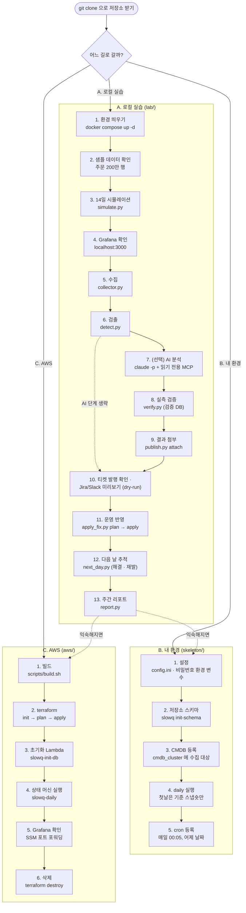
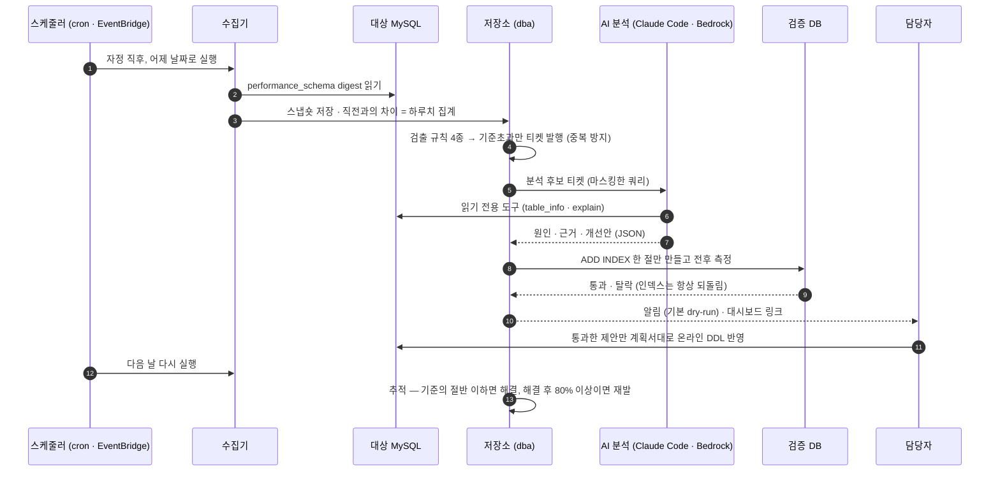

# GETTING STARTED — 전체 순서도

저장소를 방금 받은 분을 위한 **한 장짜리 길 안내**입니다. 아래 그림에서 내 길을 고르고, 그림 밑의 체크리스트를 위에서부터 한 줄씩 따라가면 됩니다. 각 줄의 「관련 문서」에 자세한 설명과 막혔을 때의 해결법이 있습니다.

## 어느 길로 갈까

| 길 | 이런 분께 | 필요한 것 | 비용 |
|---|---|---|---|
| **A. 로컬 실습 (`lab/`)** | 처음 오신 모든 분 — 강의를 따라 하며 전체 흐름을 손으로 돌려 보기 | Docker(또는 Homebrew), Python 3.10+, (AI 단계) Claude Code | 없음 |
| **B. 내 환경 (`skeleton/`)** | A 를 끝낸 뒤, 같은 흐름을 내 MySQL 에 붙이기 | 내 MySQL 접속 계정, Python, cron | 없음 |
| **C. AWS (`aws/`)** | 같은 흐름을 AWS 관리형 서비스(RDS · Lambda · Step Functions)로 올려 보기 | AWS 계정, Terraform, AWS CLI | 하루 약 $3 (다 보면 삭제) |

처음이라면 **A 를 끝까지** 해 본 뒤 B 나 C 로 가는 것을 권합니다.

## 전체 순서도

## 단계별 체크리스트

`$LAST` · `$NEXT` 는 시뮬레이션이 끝에 보여 주는 표의 「마지막 날」 · 「다음 날」 **오른쪽 날짜**입니다. 3단계 뒤에 `LAST=2026-10-13 NEXT=2026-10-14` 처럼 내 날짜로 담아 두세요.

### A. 로컬 실습 (`lab/`)

| 단계 | 명령 (어디서) | 확인 방법 | 관련 문서 |
|---|---|---|---|
| 0. 받기 | `git clone <저장소 주소>` 후 `cd slowquery-ai` | 폴더에 `lab/` · `skeleton/` · `aws/` · `docs/` 가 보임 | [README](../README.md) |
| 1. 환경 띄우기 | (`lab`) `docker compose up -d` → `python3 -m venv .venv && .venv/bin/pip install -r requirements.txt` | `docker compose logs -f shop-db order-db` 에 `port: 3306` 이 붙은 `ready for connections` 두 번 | [lab/mysql](../lab/mysql/README.md) · [01](01-database-setup.md) |
| 2. 샘플 데이터 확인 | (`lab`) `docker exec -it lab-shop-db mysql -uroot -plab-root-pw shop` → `SELECT COUNT(*) FROM orders;` | `2000000` | [lab/mysql](../lab/mysql/README.md) · [02](02-sample-data.md) |
| 3. 14일 시뮬레이션 | (`lab`) `.venv/bin/python scripts/simulate.py` | 끝에 `강의 날짜 → 내 날짜` 표 | [lab/scripts](../lab/scripts/README.md) · [05](05-slow-query-generation.md) |
| 4. Grafana 확인 | 브라우저 http://localhost:3000/d/lab-slowquery | 추이 그래프에 9일차 하락 · 12일차 재상승 | [lab/grafana](../lab/grafana/README.md) · [03](03-grafana.md) · [04](04-dashboard.md) |
| 5. 수집 (따로 해 보기) | (`lab`) `.venv/bin/python scripts/collector.py --log-date 2000-01-01` | `2000-01-01 shop-db: digest N개 수집, 일자 집계 M건`. 연습 뒤 `DELETE FROM dba.slow_digest_daily WHERE log_date = '2000-01-01';` | [lab/scripts](../lab/scripts/README.md) · [06](06-collection.md) |
| 6. 검출 | (`lab`) `.venv/bin/python scripts/detect.py --log-date $LAST` | `[날짜] 검출 N건` 과 규칙(기준초과 · 신규 · 악화 · 급증) 목록 | [lab/scripts](../lab/scripts/README.md) · [07](07-aggregation.md) |
| 7. (선택) AI 분석 | (`lab/ai`) `claude -p "$LAST shop-db 슬로우 쿼리 상위를 분석해 줘" --mcp-config mcp.json --strict-mcp-config --tools "" --allowedTools mcp__labdb__top_queries mcp__labdb__table_info mcp__labdb__explain mcp__labdb__query_trend --output-format text > run_my.txt < /dev/null` | `run_my.txt` 에 `qhash` · `cause` · `proposal` 이 든 JSON 배열 | [lab/ai](../lab/ai/README.md) · [08](08-diagnosis.md) |
| 8. 실측 검증 | (`lab/ai`) `../.venv/bin/python verify.py run_my.txt > verify_my.txt` (AI 를 건너뛰었으면 `run1.txt`) | `[xxxxxxxx] 통과` · `시간 … ms → … ms` | [lab/ai](../lab/ai/README.md) · [08](08-diagnosis.md) |
| 9. 결과 첨부 | (`lab/scripts`) `../.venv/bin/python publish.py attach ../ai/run_my.txt ../ai/verify_my.txt --log-date $LAST` | `#1 [5e9245c3] 실측 통과` | [lab/ai](../lab/ai/README.md) · [08](08-diagnosis.md) |
| 10. 티켓 · 알림 미리보기 | (`lab`) `.venv/bin/python scripts/publish.py payload 1 --to jira` (또는 `--to slack`) | `# dry-run: jira 로 보낼 내용 (실제로 보내지 않음)` + JSON. 티켓 목록은 `SELECT ticket_id, status, title FROM dba.tuning_ticket;` | [lab/scripts](../lab/scripts/README.md) · [09](09-ticket.md) |
| 11. 운영 반영 | (`lab`) `.venv/bin/python scripts/apply_fix.py plan --ticket 1` → `.venv/bin/python scripts/apply_fix.py apply --ticket 1 --log-date $NEXT` | plan: `→ 반영 가능` / apply: `티켓 #1 → IN_PROGRESS` | [lab/scripts](../lab/scripts/README.md) · [10](10-tracking-automation.md) |
| 12. 다음 날 추적 | (`lab`) `.venv/bin/python scripts/next_day.py --log-date $NEXT` | `#1 해결 확인 …s → …s` (재발이면 `재발 → 다시 열림`) | [lab/scripts](../lab/scripts/README.md) · [10](10-tracking-automation.md) |
| 13. 주간 리포트 | (`lab`) `.venv/bin/python scripts/report.py --end $NEXT` | `# 슬로우 쿼리 주간 리포트 (… ~ …)` 와 새 티켓 · 해결 · 재발 건수 | [lab/scripts](../lab/scripts/README.md) · [10](10-tracking-automation.md) |

- 티켓 번호 `1` 은 예시입니다. `SELECT ticket_id, cluster, LEFT(qhash,8) FROM dba.tuning_ticket;` 에서 **shop-db 5e9245c3** 의 번호를 쓰세요.
- 티켓 발행 자체(`tickets.py issue`)는 시뮬레이션이 날마다 이미 했습니다. 그래서 10단계는 「발행된 티켓을 확인하고 알림 본문을 미리 보는」 단계입니다.
- 코드를 고쳤다면 (`lab`) `.venv/bin/python -m unittest discover -s tests` 로 회귀를 확인합니다 ([lab/tests](../lab/tests/README.md)).

### B. 내 환경 (`skeleton/`)

| 단계 | 명령 (어디서) | 확인 방법 | 관련 문서 |
|---|---|---|---|
| 1. 설정 | (`skeleton`) `pip install -r requirements.txt` → `cp config.example.ini config.ini` (편집) → `export SLOWQ_STORE_PASSWORD=… SLOWQ_TARGET_PASSWORD=…` | `config.ini` 의 `[store]` · `[target]` 이 내 값 | [skeleton](../skeleton/README.md) |
| 2. 저장소 스키마 | (`skeleton`) `python -m slowq --config config.ini init-schema` (저장소 DB 는 먼저 `CREATE DATABASE`) | `스키마 적용 완료` | [skeleton](../skeleton/README.md) |
| 3. CMDB 등록 | 저장소에 `INSERT INTO cmdb_cluster (cluster, host, port, realm, tag, owner, owner_team, slack_channel, collect) VALUES (…, 1);` | `SELECT cluster, collect FROM cmdb_cluster;` 에 수집 대상이 `1` | [skeleton](../skeleton/README.md) · [06](06-collection.md) |
| 4. daily 실행 | (`skeleton`) `python -m slowq --config config.ini daily --date <어제>` | 첫 실행은 `수집 <클러스터>: 0개 지문`(기준 스냅숏). 다음 날부터 숫자 · `검출 N건` · `신규 티켓 N건 · 상태 변경 N건` | [skeleton](../skeleton/README.md) · [07](07-aggregation.md) · [09](09-ticket.md) |
| 5. cron 등록 | `5 0 * * *  cd <설치 경로> && python -m slowq --config config.ini daily --date $(date -d yesterday +\%F) >> daily.log 2>&1` (macOS 는 `date -v-1d +\%F`) | 다음 날 `daily.log` 에 수집 줄. 한 클러스터라도 수집 실패면 종료 코드 1 | [skeleton](../skeleton/README.md) · [10](10-tracking-automation.md) |

- 코드를 고쳤다면 (`skeleton`) `python -m unittest discover -s tests` ([skeleton/tests](../skeleton/tests/README.md)).

### C. AWS (`aws/`)

| 단계 | 명령 (어디서) | 확인 방법 | 관련 문서 |
|---|---|---|---|
| 1. 빌드 · 정적 검증 | (`aws`) `scripts/build.sh` → `scripts/validate.sh` | 해시 두 줄 · 끝 목록에 `FAIL` 없음 | [aws/scripts](../aws/scripts/README.md) · [aws/tests](../aws/tests/README.md) |
| 2. terraform | (`aws/terraform`) `cp example.tfvars terraform.tfvars` → `terraform init` → `terraform plan -out tfplan` → `terraform apply tfplan` | `Apply complete! Resources: N added …` (여기부터 과금) | [aws/terraform](../aws/terraform/README.md) |
| 3. 초기화 Lambda | `aws lambda invoke --function-name slowq-init-db --cli-read-timeout 910 --payload '{}' --cli-binary-format raw-in-base64-out /dev/stdout` | 결과 JSON 뒤 `"StatusCode": 200` | [aws/lambda](../aws/lambda/README.md) |
| 4. 상태 머신 실행 | (`aws/terraform`) `aws stepfunctions start-execution --state-machine-arn "$(terraform output -raw state_machine_arn)" --input '{}'` → 부하(`slowq-workload`) → `--input '{"log_date": "<날짜>"}'` 로 한 번 더 | `aws stepfunctions describe-execution --execution-arn <arn> --query status --output text` 가 `SUCCEEDED` | [aws/statemachine](../aws/statemachine/README.md) |
| 5. Grafana 확인 | (`aws/terraform`) `aws ssm start-session --target "$(terraform output -raw grafana_instance_id)" --document-name AWS-StartPortForwardingSession --parameters '{"portNumber":["3000"],"localPortNumber":["3000"]}'` | http://localhost:3000/d/lab-slowquery 에 그래프 | [aws/grafana](../aws/grafana/README.md) |
| 6. 삭제 | (`aws/terraform`) `terraform destroy` | `Destroy complete!` | [aws/terraform](../aws/terraform/README.md) |

- 이 폴더는 정적 검증까지만 거쳤고 실제 계정 배포 기록은 없습니다. 비용 · 보안 · 제한 사항은 [aws/README.md](../aws/README.md) 를 먼저 읽으세요.

## 하루 운영은 이렇게 돈다

길 A 의 `next_day.py`, 길 B 의 `daily` + cron, 길 C 의 상태 머신이 모두 아래 순서를 하루 한 번 반복합니다. AI 분석 · 실측 검증은 A 에서는 사람이 직접, C 에서는 상태 머신 안에서 돌고, B 에서는 선택 모듈입니다.

## 막히면 여기

| 막힌 곳 | 먼저 볼 곳 |
|---|---|
| MySQL 이 안 뜬다 · 포트 충돌 · 데이터가 덜 들어왔다 | [lab/mysql/README.md](../lab/mysql/README.md) 「자주 막히는 곳」 |
| `No module named 'pymysql'` · 스크립트 실행 위치 | [lab/scripts/README.md](../lab/scripts/README.md) 「준비물」 · [lab/README.md](../lab/README.md) 3장 |
| 시뮬레이션이 중간에 실패 · 처음부터 다시 | [lab/README.md](../lab/README.md) 6장 |
| Grafana 가 `No data` · 그래프가 비었다 | [lab/grafana/README.md](../lab/grafana/README.md) |
| `claude -p` 결과가 이상하다 · `JSON 배열이 아닙니다` | [lab/ai/README.md](../lab/ai/README.md) |
| 실습 SQL 이 `Duplicate key name` · 실행 계획이 강의와 다르다 | [lab/sql/README.md](../lab/sql/README.md) |
| `apply_fix.py` 가 종료 코드 2 로 멈춘다 | [lab/scripts/README.md](../lab/scripts/README.md) · [10](10-tracking-automation.md) |
| skeleton `비밀번호가 없습니다` · `No module named slowq` | [skeleton/README.md](../skeleton/README.md) 「처음이라면」 |
| AWS 빌드 · 검증 실패 | [aws/scripts/README.md](../aws/scripts/README.md) |
| terraform plan · apply 오류 | [aws/terraform/README.md](../aws/terraform/README.md) |
| `init-db` 시간 부족 · 상태 머신 실패 | [aws/lambda/README.md](../aws/lambda/README.md) · [aws/statemachine/README.md](../aws/statemachine/README.md) |
| 동작 원리가 궁금하다 | [docs/README.md](README.md) 목차 · [00 흐름도](00-flow.md) |
